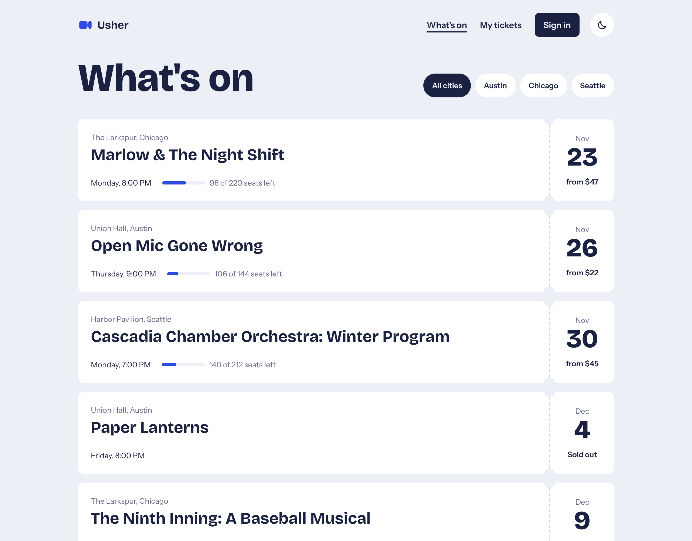
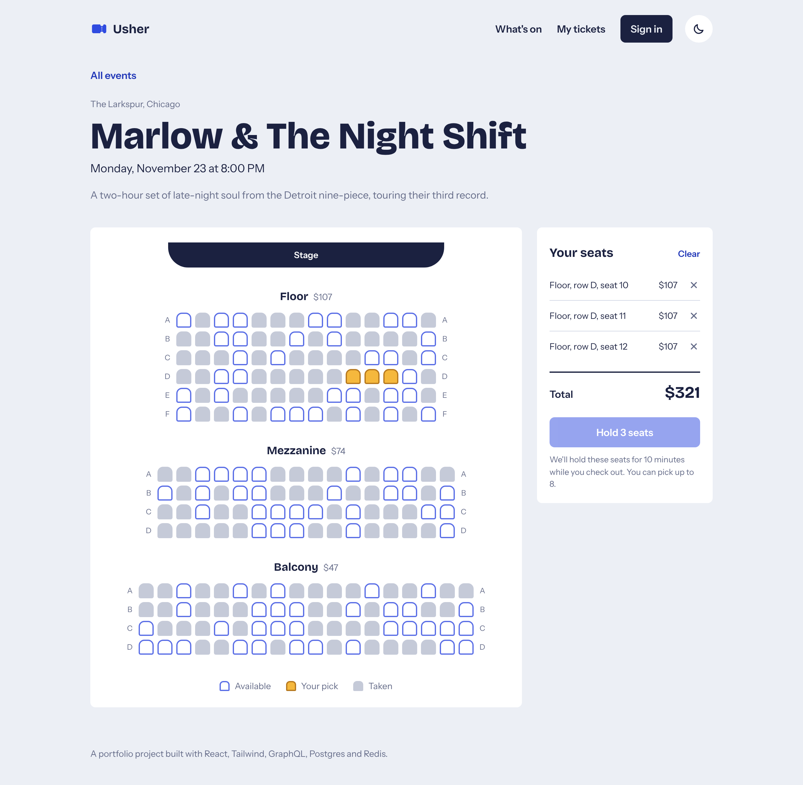
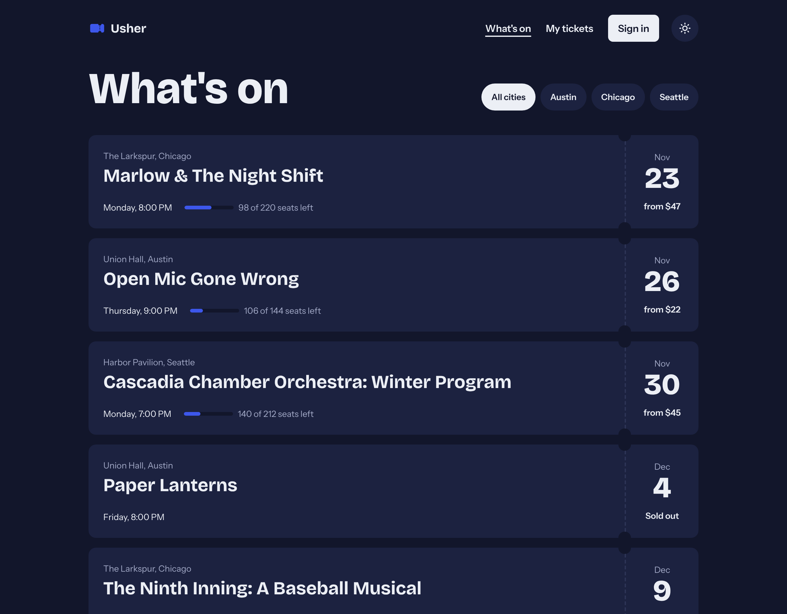
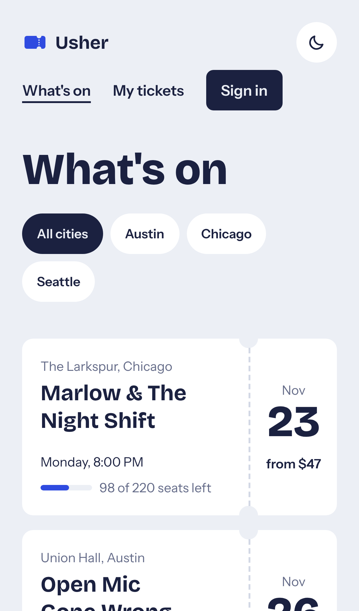

# Usher

An event ticketing app: browse shows, pick seats on a live seat map, hold them for a few minutes and check out. A full-stack TypeScript monorepo with a GraphQL API on Postgres and Redis, and a React frontend.

## Project goal

This project exists to build real backend experience on top of existing frontend skills, and to have something concrete to point to in full-stack interviews.

Ticketing was chosen because it can't be built well without solving the problems backend engineers are actually hired to solve:

- **Correctness under concurrency.** Two people click the same seat at the same moment, and exactly one of them gets it. That takes Postgres transactions, row locks and constraints, not just application code.
- **State that expires.** A held seat must return to the pool after 10 minutes, even if the user closes the tab. Redis TTLs and background jobs handle that.
- **Money.** Checkout means payment webhooks, idempotency keys and keeping the payment provider and the database in agreement.
- **Traffic spikes.** A popular on-sale draws far more users than seats. Caching, rate limiting and a waiting-room queue keep the system up and fair.

"Design Ticketmaster" is also one of the most common system-design interview questions, so the aim is to answer it from experience rather than from a prep guide.

The specific skills this project practices:

| Area | What it's used for here |
| --- | --- |
| **PostgreSQL** | Relational modeling, migrations, constraints, indexes, keyset pagination, transactions and row locking |
| **Redis** | Cache-aside caching, sessions, TTL-based expiry, pub/sub, rate limiting, queues |
| **GraphQL** | Schema-first API design, resolvers, DataLoader batching, subscriptions, typed clients via codegen |
| **Tailwind CSS** | A custom design system with v4 theme tokens, built without a component library |

The frontend (React, TypeScript, Vite, TanStack Query, Zustand) is the familiar ground the backend work builds on. Everything beyond the starting skeleton is built by hand, milestone by milestone.

## Status

**v0.1: browsing and seat picking, plus accounts.** Part 1 of the build (the read path) is complete. Part 2 has accounts and sessions, and a `holdSeats` API that can't give one seat to two people. Next up is making holds expire, then the hold UI. The [UI mocks](https://claude.ai/artifact/QS7H9cFWNASXjXmbyuvah5) show where it's headed.



| Event page and seat map | Dark theme | Phone |
| --- | --- | --- |
|  |  |  |

### What works

- **Event list with live seat counts.** Each ticket shows seats left and the cheapest available price, filterable by city (kept in the URL), with "Show more" pagination.
- **Event page with a seat map.** Pick up to 8 seats with mouse or keyboard; a side panel lists them with a running total. Seat status refreshes every 15 seconds.
- **Accounts.** Create an account or sign in from the header or the seat panel, and you're taken back to where you were, with your picked seats still there. You stay signed in for 30 days after your last visit, across API restarts.
- **Light and dark themes** that follow the OS until you choose, with no flash on load.
- **Loading, empty and error states** throughout, and layouts that work down to phone width.

### How it's built

- **Postgres schema and migrations** with Drizzle: venues, sections, seats, events and per-event seats, with constraints and indexes that match the queries.
- **Keyset (cursor) pagination.** `events(first, after)` pages with a `(starts_at, id) > (…)` row comparison backed by a composite index, so pages never repeat or skip events and stay fast however deep you go. Cursors are opaque and validated.
- **No N+1 queries.** DataLoader batches venues and availability, so a page of events costs a fixed number of queries.
- **Cache-aside availability in Redis.** Seat counts come from one `count(*) FILTER (…)` query per page, cached for 10 seconds: one `MGET` per page, SQL only for misses, and the app keeps working on Postgres alone if Redis is down. The cache is only ever used for display, never to decide whether a seat can be held.
- **Sessions in Redis rather than JWTs.** Signing in stores a random 256-bit session id, mapped to the user id, in Redis with a 30-day TTL that slides on every request. The browser holds it in an `httpOnly`, `SameSite=Lax` cookie. Signing out deletes the key, so the session ends on the server straight away, which a JWT can't do without a deny list.
- **Holding seats without double-booking.** `holdSeats` runs in one transaction: it locks the requested seat rows with `SELECT … FOR UPDATE`, always in id order so overlapping requests can't deadlock, checks they're free, then creates the hold. A second request for the same seat waits at the lock and then sees it taken. Losing a seat comes back as a `SeatsUnavailable` result listing the seats, not an error. Rules: up to 8 seats, one active hold per person per event (enforced with a transaction-scoped advisory lock). `pnpm prove:holds` fires 50 simultaneous requests for one seat and checks that exactly one wins; without `FOR UPDATE`, nearly all of them do.
- **Holds expire by definition.** A seat is held only while its `hold_id` points at a hold whose `expires_at` (set from the database clock) hasn't passed. There's no "held" status to keep in step, so an expired hold frees its seats immediately, with no background job needed for correctness.
- **Passwords hashed with Argon2id.** The rules follow the shape of NIST SP 800-63B (a minimum length, no "must contain a symbol" rules), with a deliberately low 6-character minimum for the demo. Sign-in gives the same message, and takes the same time, whether or not an email has an account, so it can't be used to find out who's registered. The sign-in page only redirects back to paths on this site, so its `?next=` parameter can't be used for phishing links.
- **Typed end to end.** GraphQL Code Generator produces resolver types for the API and typed documents for the web app from one `schema.graphql`.
- **Accessible seat map.** Every seat is a real button whose label gives section, row, number, price and state, so it works with a keyboard and a screen reader.

## Tech stack

| Layer | Choice |
| --- | --- |
| Monorepo | pnpm workspaces (`apps/api`, `apps/web`) |
| API | Node.js, Express 5, Apollo Server 5 |
| Database | PostgreSQL 18, Drizzle ORM and Drizzle Kit migrations |
| Cache and queues | Redis 8 via ioredis |
| Types | GraphQL Code Generator (resolver types for the API, typed documents for the web app) |
| Web | React 19, Vite 8, TypeScript, Tailwind CSS v4, React Router |
| Data fetching | TanStack Query (server state) and Zustand (client UI state) |
| Local services | Docker Compose |

## Getting started

### Prerequisites

- **Node.js 22.12 or newer.** Node 24 LTS is recommended; run `nvm use` to pick it up from `.nvmrc`.
- **pnpm 12.** Run `corepack enable` and pnpm will use the version pinned in `package.json`. If corepack isn't available, use `npm install -g pnpm`.
- **A Docker engine**, such as [Docker Desktop](https://www.docker.com/products/docker-desktop/) or [OrbStack](https://orbstack.dev). Open the app once after installing so the `docker` command is set up, and keep it running while you work.

### First run

```bash
pnpm install        # install dependencies for both apps
pnpm bootstrap      # start Postgres and Redis, run migrations, load sample data
pnpm dev            # run the API and web app together
```

Then open:

- Web app: http://localhost:5173
- GraphQL API and Apollo Sandbox: http://localhost:4000/graphql
- Service status page: http://localhost:5173/health (whether the API, Postgres and Redis are reachable)
- Health check endpoint: http://localhost:4000/health

The API works without a `.env` file because its defaults match `docker-compose.yml`. To change anything, copy `apps/api/.env.example` to `apps/api/.env`.

Recommended VS Code extensions: Tailwind CSS IntelliSense (`bradlc.vscode-tailwindcss`) and GraphQL (`graphql.vscode-graphql` and `graphql.vscode-graphql-syntax`). The included `graphql.config.yml` gives you autocomplete and validation inside `graphql(...)` queries.

## Scripts

Run these from the repository root.

| Command | What it does |
| --- | --- |
| `pnpm bootstrap` | Start the containers, apply migrations and seed sample data (first run, or after `services:reset`) |
| `pnpm dev` | Generate GraphQL types, then run the API (port 4000) and web app (port 5173) in watch mode |
| `pnpm services:up` / `services:down` | Start or stop the Postgres and Redis containers |
| `pnpm services:reset` | Delete all container data and start fresh |
| `pnpm db:generate` | Create a SQL migration from `apps/api/src/db/schema.ts` |
| `pnpm db:migrate` | Apply pending migrations |
| `pnpm db:seed` | Replace all data with the sample venues and events (this deletes any accounts too), and clear cached data in Redis |
| `pnpm db:studio` | Open Drizzle Studio to browse the database |
| `pnpm prove:holds` | Race 50 simultaneous holds for one seat against your local database and check exactly one succeeds (cleans up after itself) |
| `pnpm codegen` | Regenerate TypeScript types from `apps/api/schema.graphql` |
| `pnpm typecheck` / `pnpm build` | Typecheck or build both apps |

## Project structure

```
apps/
  api/
    schema.graphql           The API contract. Both apps generate types from it.
    drizzle/                 SQL migrations generated from db/schema.ts
    src/
      index.ts               Express + Apollo Server, health check, graceful shutdown
      env.ts                 Configuration with local defaults
      health.ts              Postgres and Redis connectivity check
      redis.ts               Redis client (fails fast when Redis is down)
      cache.ts               Cache-aside helper: MGET, fetch misses, write back with a TTL
      auth/
        sessions.ts          Redis sessions and the session cookie
        passwords.ts         Argon2id hashing and the rules for new passwords
      db/
        schema.ts            Tables, enums, constraints and indexes
        client.ts            Connection pool and Drizzle instance
        availability.ts      Seat counts for many events in one query
        holds.ts             holdSeats: the locking transaction behind holding seats
        seatStatus.ts        What "held" means: the join and SQL every seat query shares
        seed.ts              Loads the sample data and clears the cache
        seed-data.json       Sample venues and events
      scripts/
        prove-holds.ts       50 people, one seat, at once: proves only one gets it
      graphql/
        resolvers.ts         Query, mutation and type resolvers (including holdSeats)
        loaders.ts           Per-request DataLoaders (venues, cached availability)
        cursor.ts            Opaque pagination cursors
        context.ts           Per-request context: loaders and the signed-in user
  web/
    src/
      main.tsx               TanStack Query setup and app root
      router.tsx             Routes
      index.css              Tailwind theme tokens, light and dark
      routes/                Pages: event list, event page, sign in, health, not found
      components/            Ticket card, seat map, picked-seats panel, header account controls, skeletons, states
      components/auth/       Sign-in and create-account forms
      components/ui/         Shared controls: Button, FilterPill, SegmentedControl, TextField, PasswordField, FormAlert, focus and control styles
      stores/                Zustand stores: theme preference, picked seats
      lib/                   GraphQL client, the event query, auth hooks, safe redirects, date and price formatting
docs/screenshots/            Images used in this README
docker-compose.yml           Postgres 18 and Redis 8
```

## Troubleshooting

- **`docker: command not found`.** Install Docker Desktop or OrbStack and open it once. If Docker Desktop is installed, check Settings, then Advanced, and set the CLI tools install to System.
- **Port 5432 or 6379 is already in use.** Another Postgres or Redis is running locally. Stop it, or start the containers on other ports with `POSTGRES_PORT=5433 REDIS_PORT=6380 pnpm services:up` and set the matching URLs in `apps/api/.env`.
- **`Cannot find module './gql'` or missing generated types.** Run `pnpm codegen`. Generated files are not committed.
- **The event list is empty.** The database has no data yet. Run `pnpm db:seed` (or `pnpm bootstrap` on a fresh setup).
- **"The API responded with 502"** in the web app means the API isn't running. Start it with `pnpm dev`.
